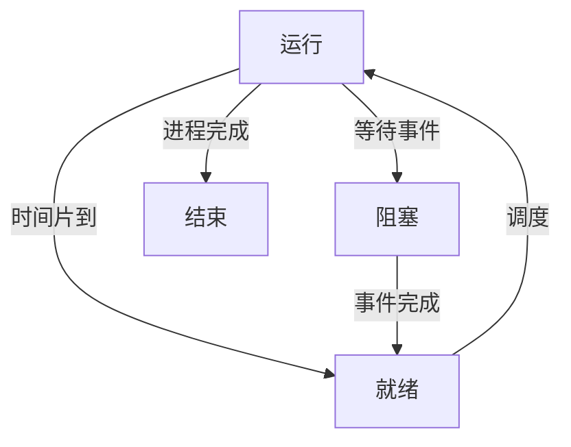
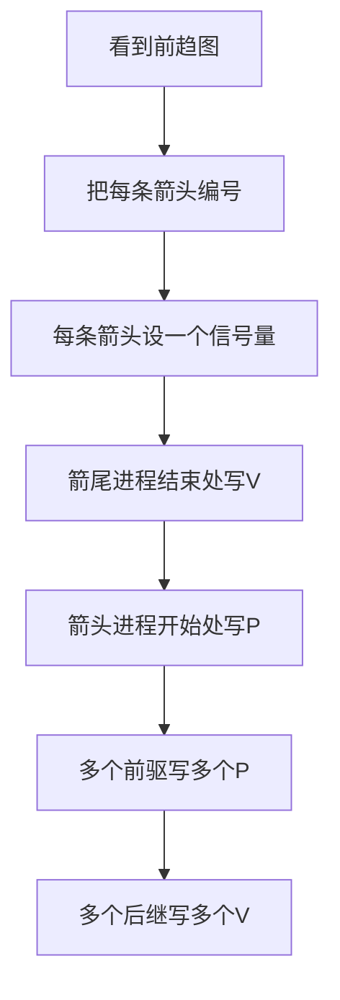

## 2. 进程与三态模型

### 1. 知识点

| 状态 | 是否占有 CPU | 是否具备运行所需资源 | 说明 |
|---|---:|---:|---|
| 运行 | 是 | 是 | 正在处理机上执行 |
| 就绪 | 否 | 是 | 万事俱备，只差 CPU |
| 阻塞/等待 | 否 | 否 | 等待 I/O、事件或资源 |

### 2. 状态转换图



### 3. 做题模板

```text
三态题判断：
1. 谁当前运行？
2. 若时间片到：运行 -> 就绪，队首就绪 -> 运行
3. 若运行进程释放某设备：等待该设备的进程 -> 就绪，不一定立即运行
4. 单处理机下同时只能有一个运行进程
5. FCFS下通常先到的就绪进程优先运行
```

### 4. 例题分析

**例 1：释放扫描仪后的状态判断**  
题干：单处理机，P1运行，P2就绪，P3等待打印机，P4等待扫描仪。若 P1 释放扫描仪。  
先抓题眼：P1释放的是扫描仪，所以等待扫描仪的 P4 被唤醒，进入**就绪**。P1没有放弃 CPU，所以 P1仍是运行；P2仍就绪；P3仍等待打印机。  
**正确答案**：B  
**答案方向**：释放设备只唤醒等待该设备的进程为就绪，不代表立刻运行。

**例 2：时间片到后的状态判断**  
若 P1 时间片到，则 P1 从运行转为就绪，P2 按先来先服务进入运行，P3/P4仍等待各自设备。  
**正确答案方向**：P1就绪、P2运行、P3等待、P4等待。

### 5. 记忆技巧

```text
就绪只差CPU，阻塞还差事件；
释放设备只唤醒，是否运行看调度。
```

---

## 3. 前趋图与 PV 操作

### 1. 知识点

| 图中关系 | PV设置 | 解释 |
|---|---|---|
| $P_i \rightarrow P_j$ | 设信号量 $S_{ij}=0$ | 表示 $P_j$ 必须等待 $P_i$ 完成 |
| 前驱进程结束后 | $V(S_{ij})$ | 通知后继：我完成了 |
| 后继进程开始前 | $P(S_{ij})$ | 等待前驱完成 |
| 一个进程有多个前驱 | 开始前做多个 P | 所有前驱都完成才可运行 |
| 一个进程有多个后继 | 结束后做多个 V | 分别通知所有后继 |

### 2. 公式/模板

```text
前趋图PV模板：
每一条箭头 = 一个同步信号量，初值0

Pi --> Pj
Pi结尾：V(Sij)
Pj开头：P(Sij)

多个箭头进入某进程：
Pj开头：P(Sa) P(Sb) ...

多个箭头离开某进程：
Pi结尾：V(Sx) V(Sy) ...
```

### 3. 流程图



### 4. 例题分析

**例 1：P1、P2、P3、P4前趋图题**  
先抓题眼：题目给出多个进程的先后约束，并要求在程序空缺处填 P/V 操作。  
解题时不要直接看选项，先把图中的每条边当作一个信号量。例如若存在：

```text
P1 ──S1──> P3
P2 ──S2──> P3
P3 ──S4──> P4
```

则应写成：

```text
P1结束：V(S1)
P2结束：V(S2)
P3开始：P(S1) P(S2)
P3结束：V(S4)
P4开始：P(S4)
```

**答案方向**：箭尾写 V，箭头写 P；一个结点有几个入边，开始前就有几个 P。

**例 2：P1〜P5前趋图题**  
这类题经常设置 5 个或 6 个信号量。做法仍不变：

| 步骤 | 做法 |
|---|---|
| 第一步 | 先数箭头数，通常箭头数 = 同步信号量数 |
| 第二步 | 给每条箭头编号，如 S1、S2、S3 |
| 第三步 | 写出每个进程的“前置 P”和“后置 V” |
| 第四步 | 与选项逐项匹配 |

**答案方向**：不要背具体年份题答案，背“边对应信号量”的机械规则。

### 5. 易错提醒

| 易错点 | 正确处理 |
|---|---|
| 把 P/V 写反 | 前驱完成后 V，后继开始前 P |
| 一个进程多个前驱只写一个 P | 每个前驱都要等，所以写多个 P |
| 一个进程多个后继只写一个 V | 每个后继都要通知，所以写多个 V |
| 信号量初值写成 1 | 前趋同步信号量初值通常是 0 |

### 6. 记忆技巧

```text
箭尾释放V，箭头等待P；
几条箭头进，就有几个P；
几条箭头出，就有几个V。
```

---

## 4. 信号量机制与 PV 操作

### 1. 知识点

| 操作 | 含义 | 数学变化 | 结果 |
|---|---|---|---|
| P(S) | 申请资源 | $S=S-1$ | 若 $S<0$，进程阻塞 |
| V(S) | 释放资源 | $S=S+1$ | 若释放前有等待者，唤醒一个进程 |
| 互斥信号量 | 控制临界区一次只允许一个进程进入 | 初值通常为 1 | P进V出 |
| 同步信号量 | 控制先后顺序 | 初值通常为 0 | 前者V，后者P |
| 资源信号量 | 控制同类资源数量 | 初值为资源数 | 负值绝对值为等待进程数 |

### 2. 信号量数值意义

| 信号量值 | 含义 |
|---:|---|
| $S>0$ | 还有 $S$ 个可用资源 |
| $S=0$ | 没有空闲资源，但暂无进程等待 |
| $S<0$ | 无可用资源，且有 $|S|$ 个进程等待 |

### 3. 例题分析

**例 1：信号量为 -3**  
题干：n 个进程共享一台扫描仪，信号量 S = -3。  
先抓题眼：负信号量。负值的绝对值就是等待队列中的进程数。  
**正确答案**：C（3）  
**答案方向**：看到 S 为负，直接取绝对值。

**例 2：n 个进程共享两台打印机，信号量范围**  
初值为 2。最多有 n 个进程都执行 P 操作，其中 2 个获得打印机，其余 $n-2$ 个等待。  
最小值为：

$$
2-n
$$

最大值为 2。  
**答案方向**：资源数为 $r$、进程数为 $n$，信号量范围通常为 $[r-n, r]$。

**例 3：共享 3 台扫描仪，S 当前为 1，又执行两次 P 操作**  
每次 P 操作使 S 减 1，所以：

$$
S = 1 - 2 = -1
$$

**答案方向**：P 是减法，不管题干多长，先按次数减。

### 4. 互斥与同步对照

| 场景 | 信号量初值 | P/V位置 |
|---|---:|---|
| 互斥访问临界资源 | 1 | 进入临界区前 P，退出后 V |
| 生产者-消费者空缓冲区 | 缓冲区容量 n | 生产前 P(empty)，生产后 V(full) |
| 生产者-消费者满缓冲区 | 0 | 消费前 P(full)，消费后 V(empty) |
| 前趋同步 | 0 | 前驱结束 V，后继开始 P |

### 5. 记忆技巧

```text
P减资源，V加资源；
互斥初值一，同步初值零；
负数不神秘，绝对值是等待数。
```

---

## 5. 进程同步与互斥应用题

### 1. 生产者—消费者模型

| 信号量 | 含义 | 初值 |
|---|---|---:|
| mutex | 互斥访问缓冲区 | 1 |
| empty | 空缓冲区数量 | n |
| full | 满缓冲区数量 | 0 |

### 2. 伪代码模板

```text
生产者：
P(empty)
P(mutex)
放入产品
V(mutex)
V(full)

消费者：
P(full)
P(mutex)
取出产品
V(mutex)
V(empty)
```

### 3. 例题分析

**例 1：半成品箱容量为 n**  
题干：甲放入半成品，乙取出半成品继续加工。  
先抓题眼：箱子容量 n；一开始箱子为空。  
因此空位信号量初值 n，产品信号量初值 0，互斥信号量初值 1。  
**正确答案**：互斥信号量初值 B（1）；S1/S2 初值 A（n、0）  
**答案方向**：空位初值 = 容量；产品初值 = 0；互斥初值 = 1。

**例 2：自动售票系统互斥访问剩余票数**  
多个售票终端同时修改剩余票数，核心是保护共享变量。  
信号量 S 是互斥信号量，初值为 1。访问临界区前 P(S)，离开临界区后 V(S)。  
**正确答案方向**：S=1；进入修改票数前 P，修改完成后 V。

### 4. 记忆技巧

```text
有箱子：空位n，产品0；
有共享变量：互斥1；
进入先P，出来后V。
```

---

## 6. 死锁

### 1. 知识点

| 项目 | 内容 |
|---|---|
| 死锁含义 | 多个进程互相等待对方占有的资源，导致都无法推进 |
| 死锁必要条件 | 互斥、占有并等待、不可剥夺、循环等待 |
| 死锁处理 | 鸵鸟策略、预防、避免、检测与解除 |
| 常考方向 | 给 n 个进程、每个最多需要 w 个资源，问至少多少资源不死锁 |

### 2. 核心公式

对于 $n$ 个进程，每个进程最多需要 $w$ 个同类互斥资源，保证不发生死锁的最少资源数为：

$$
m_{\min}=n(w-1)+1
$$

等价地：

```text
每个进程最多先拿 w-1 个资源，还差1个才完成。
如果系统还能多出1个资源，就至少能让一个进程完成；
该进程释放资源后，其他进程依次完成。
```

### 3. 例题分析

**例 1：6个进程，每个需要2个资源**  
套公式：

$$
m_{\min}=6(2-1)+1=7
$$

**正确答案**：B（7）  
**答案方向**：$n(w-1)+1$。

**例 2：5个进程，每个需要3个资源**  
套公式：

$$
m_{\min}=5(3-1)+1=11
$$

**正确答案**：C（11）  
**答案方向**：最多每个进程先占 2 个，再多 1 个破局。

**例 3：3个进程，每个需要5个资源**  
套公式：

$$
m_{\min}=3(5-1)+1=13
$$

**正确答案**：B（13）  
**答案方向**：不是 $3\times5=15$，只要能保证至少一个进程完成即可。

**例 4：资源数为8，3个进程，每个进程都需要 i 个，问可能死锁的最小 i**  
系统不死锁条件：

$$
8 \ge 3(i-1)+1
$$

整理：

$$
8 \ge 3i-2
$$

$$
10 \ge 3i
$$

所以 $i \le 3$ 时保证不死锁，可能死锁的最小值是 $i=4$。  
**正确答案**：D（4）  
**答案方向**：问“可能死锁的最小 i”，先求“不死锁最大 i”，再加 1。

### 4. 记忆技巧

```text
死锁资源最少数：
每人先拿差一个，再给一个就破局。
公式 n(w-1)+1。
```

---

## 7. 进程资源图

### 1. 知识点

| 图形元素 | 含义 |
|---|---|
| 进程结点 | P1、P2、P3 |
| 资源结点 | R1、R2 |
| 资源 → 进程 | 资源已分配给该进程 |
| 进程 → 资源 | 进程正在申请该资源 |
| 非阻塞结点 | 当前可获得所需资源，能运行完成 |
| 阻塞结点 | 当前申请资源不能被满足 |

### 2. 化简模板

```text
进程资源图化简：
1. 先统计每类资源总量和已分配量。
2. 判断某进程申请的资源当前是否可满足。
3. 若可满足，该进程是非阻塞结点，可运行完成。
4. 运行完成后释放它占有的全部资源。
5. 重复判断。
6. 若所有进程都能删除，则非死锁。
7. 若剩余进程都无法满足申请，则死锁。
```

### 3. 例题分析

**例 1：图中有非阻塞结点**  
先抓题眼：不要只看是否有环。考试题通常要求“能否化简”。  
若某进程申请可满足，就让该进程运行完并释放资源。释放后其他进程可能变为非阻塞。  
**答案方向**：只要可以逐步删完所有进程，就是非死锁。

**例 2：没有一个进程是非阻塞结点**  
若每个进程都在等待当前不可获得的资源，且无法找到第一个可完成进程，则图不可化简。  
**答案方向**：不可化简通常判为死锁。

### 4. 记忆技巧

```text
资源图先分配，再申请；
能跑完就释放，删完就是安全；
一个都跑不了，基本就是死锁。
```

---

## 8. 死锁避免与银行家算法

### 1. 知识点

| 概念 | 含义 |
|---|---|
| Max | 进程最大资源需求 |
| Allocation | 已分配资源 |
| Need | 尚需资源，$Need=Max-Allocation$ |
| Available | 当前可用资源 |
| 安全序列 | 存在一个进程执行顺序，使所有进程最终完成 |
| 不安全状态 | 不一定已经死锁，但存在进入死锁的风险 |

### 2. 解题模板

```text
银行家算法：
1. 计算 Need = Max - Allocation。
2. 计算 Available = 总资源 - 已分配总和。
3. 找 Need <= Available 的进程。
4. 假设该进程完成，Available += Allocation。
5. 重复直到所有进程完成。
6. 能找到完整序列：安全；找不到：不安全。
```

### 3. 例题分析

**例：企业资金分配题**  
这类题只是银行家算法换成“资金”。  
- 最大资金需求 = Max；
- 已用资金 = Allocation；
- 尚需资金 = Need；
- 企业可用资金 = Available。

先计算每个项目尚需资金，再判断有没有项目的尚需资金不超过可用资金。若能让一个项目完成并还款，就把它已用资金加回可用资金。  
**答案方向**：资金题本质就是银行家算法，不要被“投资款”场景干扰。

### 4. 记忆技巧

```text
银行家不看已用多少，先看还差多少；
谁差得少先满足，完成归还再继续。
```

---

## 9. 线程

### 1. 知识点

| 项目 | 进程 | 线程 |
|---|---|---|
| 基本角色 | 资源分配单位 | 调度和执行单位 |
| 拥有资源 | 拥有独立地址空间和资源 | 基本不独立拥有系统资源 |
| 切换开销 | 较大 | 较小 |
| 可共享内容 | 不同进程一般不共享地址空间 | 同一进程内线程共享代码、全局变量、打开文件 |
| 不共享内容 | — | 各线程私有栈、寄存器、程序计数器 |

### 2. 例题分析

**例 1：线程不能共享什么？**  
选项通常有代码段、打开文件、全局变量、某线程栈指针。  
同一进程内线程共享进程资源，但线程自己的运行现场不能被其他线程共享。  
**正确答案**：某线程的栈指针。  
**答案方向**：看到“某线程的栈指针”，优先判断为不能共享。

**例 2：线程共享叙述错误项**  
“线程 T1、T2 可以共享 T3 的栈指针”是错误的。  
**答案方向**：线程共享进程级资源，不共享其他线程的私有栈和执行现场。

### 3. 记忆技巧

```text
线程共进程资源，不共线程私货；
代码文件全局共，栈和寄存器不共。
```

---

## 10. 局部性原理与页面置换

### 1. 知识点

| 类型 | 含义 | 典型原因 |
|---|---|---|
| 时间局部性 | 访问过的指令或数据不久可能再次访问 | 循环 |
| 空间局部性 | 访问某地址后，不久可能访问其附近地址 | 顺序执行 |
| 修改位 | 页面是否被修改 | 修改过的页淘汰代价大 |
| 访问位 | 页面近期是否被访问 | 未访问页优先淘汰 |

### 2. 页面淘汰常见原则

若题目给出状态位、访问位、修改位，通常按以下思路：

```text
1. 状态位为0：页面不在内存，不作为淘汰候选。
2. 状态位为1：页面在内存，可作为候选。
3. 优先淘汰访问位为0的页。
4. 在访问位相同条件下，优先淘汰修改位为0的页。
5. 修改过的页写回磁盘，代价更大。
```

### 3. 例题分析

**例：访问页面不在内存时，淘汰代价最小的页面**  
先抓题眼：淘汰代价最小，不是最近最久未用。  
通常未访问、未修改的页代价最低；已修改页需要写回磁盘，代价更高。  
**答案方向**：在内存页中找“访问位 0、修改位 0”的页。

### 4. 记忆技巧

```text
换页看在内存，
淘汰看代价；
未访问优先，
未修改更佳。
```


# **考点1  进程与线程的概念**
进 程 与 程 序 的 区 别 ： 进 程 是 程 序 的 一 次 执 行 过 程 ， 没 有 程 停 就 没 有 进 程

进 裎 是 程 序 在 一 个 数 据 集 合 上 运 行 的 过 程 ， 它 是 系 统 进 行 资 源 分 配 和 调 度 的 一 个 独 立 单 位 。 它 由 裎 序 块 、 进 程 控 制 块 (PCB) 和 数 据 块 三 部 分 组 成 。 

PCB ： PCB 是 进 程 存 在 的 嚡 一 标 志 。 内 容 包 含 进 程 标 识 符 ` 状 态 ` 位 置 信 息 、 控 制 信 息 、 队 列 指 针 （ 链 接 同 一 状 态 的 进 程 ） 、 优 先 级 、 现 场 保 护 区 等

# **考点2  进程的状态**
三态图
运行、就绪、等待
只有运行状态下的进程释放了CPU，就绪状态的进程才会进入运行状态，等待状态的进程释放了除去CPU外的东西会进入就绪状态、只有释放了其他东西和CPU才会进入运行状态

五态图

**例 1：释放扫描仪后的状态判断**  
题干：单处理机，P1运行，P2就绪，P3等待打印机，P4等待扫描仪。若 P1 释放扫描仪。  
先抓题眼：P1释放的是扫描仪，所以等待扫描仪的 P4 被唤醒，进入**就绪**。P1没有放弃 CPU，所以 P1仍是运行；P2仍就绪；P3仍等待打印机。  
**正确答案**：B  
**答案方向**：释放设备只唤醒等待该设备的进程为就绪，不代表立刻运行。

**例 2：时间片到后的状态判断**  
若 P1 时间片到，则 P1 从运行转为就绪，P2 按先来先服务进入运行，P3/P4仍等待各自设备。  
**正确答案方向**：P1就绪、P2运行、P3等待、P4等待。

# 考点3 信号量与PV操作
## 进程的同步与互斥
临 界 资 源 ： 诸 进 程 间 需 要 互 斥 方 式 对 其 进 行 共 享 的 资 源
注 ： 临 界 资 源 同 一 时 刻 只 允 许 一 个 进 程 使 用 ， 共 享 资 源 同 一 时 刻 允 许 多 个 进 程 同 时 使 用 。
## PV操作
P操作
申请并锁定资源
V操作
释放并解锁资源

# 考点4 前趋图与PV操作
技巧
1 、 前 驱 图 中 有 几 条 线 就 有 几 个 信号量 ， 倌 号 虽 初 始 值 都 是 0 
2 、 对 于 某 个 结 点 ， 有 几 条 入 线 ， 就 有 几 个 p 操 作 ； 有 几 条 出 线 ， 就 有 几 个 v 操 作 

# 考点5 死锁问题

死锁的四大条件

死锁资源数计算
不可能发生死锁的最小资源数（W-1）* M+1 <= n
m进程数
w每个进程需要的资源数
n系统中该类资源的总数

# 考点6 进程资源图
阻 塞 结 点 ： 当 前 资 源 不 足 以 支 撑 执 行 的 进 程 结 点 。 
非 阻 塞 结 点 ： 当 前 资 源 足 够 支 撑 执 行 的 进 程 结 点 。
