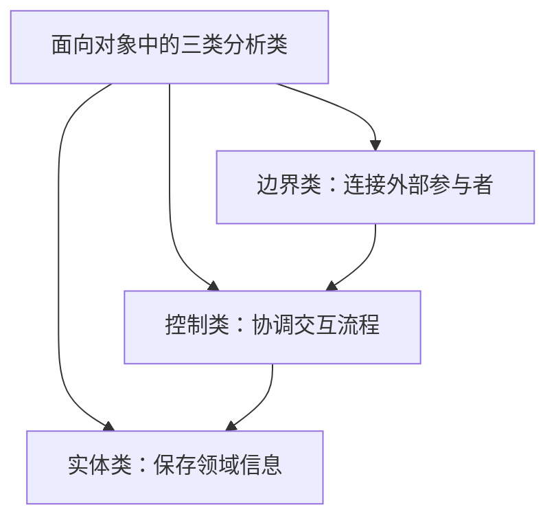

### 1. 知识点

| 类类型 | 作用 | 常见题眼 | 答案方向 |
|---|---|---|---|
| 实体类 | 保存系统中需要长期存在的信息，并提供相关处理行为 | 核心类、保存信息、领域对象 | 实体类 |
| 边界类 / 接口类 | 连接系统内对象与系统外参与者 | 用户交互、外部参与者、界面、接口 | 边界类 / 接口类 |
| 控制类 | 协调边界类和实体类之间的交互 | 协调、控制活动流、用例控制行为 | 控制类 |
| 一般—特殊关系 | 父类与子类关系 | 交通工具与飞机、Animal 与 Bird | 继承 / 泛化 |

### 2. 图示



### 3. 例题分析

**例 1**：应用领域中的核心类，一般用于保存系统中的信息并提供相关处理行为。  
题眼是“核心类、保存信息、处理行为”，直接落到**实体类**。

**例 2**：系统内对象和系统外参与者的联系媒介。  
题眼是“联系媒介、系统外参与者”，直接落到**边界类**。

**例 3**：交通工具与飞机之间是什么关系？  
交通工具是一般概念，飞机是特殊概念，所以是一般—特殊关系，也就是继承/泛化关系。

### 4. 记忆技巧

```text
实体管数据，边界接外部，控制管流程；
一般特殊看“是不是一种”，飞机是交通工具。
```
