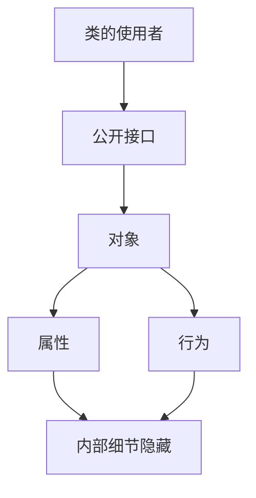

### 1. 知识点

| 考点 | 正确说法 | 易错说法 |
|---|---|---|
| 封装本质 | 信息隐藏 | 封装是多态、聚合 |
| 封装对象 | 数据和行为的整体 | 只封装数据 |
| private | 只有此类中定义的方法可访问 | 同包类、所有 public 方法都可访问 |
| 软件复用作用 | 使用者不需要知道组件内部如何工作 | 不需要写文档、组件一定更有效 |
| 类定义 | 一组对象的抽象定义 | 一组对象的实例 |
| 成员变量/成员函数 | 属性和方法 | 值和方法、属性和活动 |
| this | 区分对象属性与局部变量名 | private、protected、public |

### 2. 图示



### 3. 例题分析

**例 1**：在定义类时，将属性声明为 private 的目的是什么？  
题眼是“private”。private 的目的不是让属性不可更改，而是实现数据隐藏，避免外部随意访问和意外更改。

**例 2**：封装在软件复用中的作用是什么？  
题眼是“复用”。封装让其他开发人员无需了解组件内部工作机制，只需要通过接口使用。

### 4. 记忆技巧

```text
封装是信息隐藏，数据行为绑一起；
private 只让本类碰，this 区分同名变量。
```
