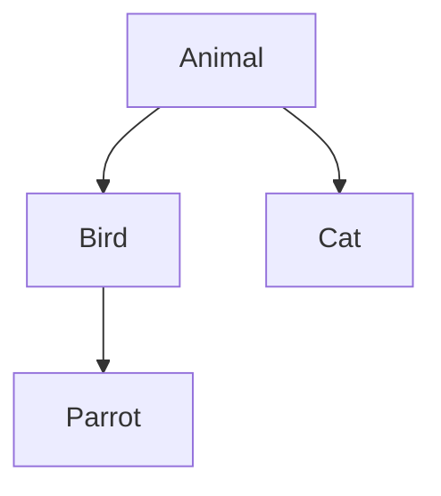

### 1. 知识点

| 考点 | 正确说法 | 易错点 |
|---|---|---|
| 继承定义 | 父类和子类之间共享数据和方法的机制 | 不是封装、不是消息 |
| 关系本质 | 一般—特殊关系 | 平级概念不是继承 |
| 子类能力 | 可以拥有父类属性和方法，也可以有新的属性和行为 | 只能新增行为、只能有父类属性 |
| 多重继承 | 两个及以上类作为一个类的超类 | 可能产生二义性成员 |
| 继承用途 | 在已存在类的基础上创建新类 | 不是在已存在状态中添加状态 |
| 继承限制 | 有些语言只支持单继承，有些支持多继承 | “继承仅允许单重继承”绝对化错误 |

### 2. 继承关系图



### 3. 例题分析

**例 1**：继承仅仅允许单重继承，不允许一个子类有多个父类。  
题眼是“仅仅”。面向对象继承机制本身可以有单继承和多继承，不同语言支持程度不同，因此该说法错误。

**例 2**：采用继承机制创建子类时，子类中可以有什么？  
子类可以继承父类属性和行为，也可以新增自己的属性和行为。因此选“可以有新的属性和行为”。

### 4. 记忆技巧

```text
继承看父子，一般到特殊；
子类可继承，也能加新招；
多继承很强，但可能二义。
```
