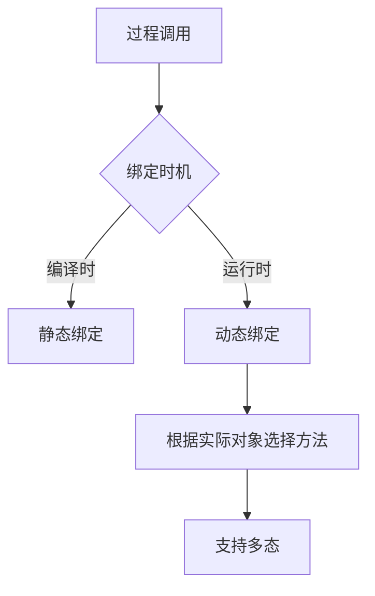

### 1. 知识点

| 概念 | 绑定时机 | 依据 | 作用 |
|---|---|---|---|
| 静态绑定 | 编译时 | 静态类型 | 编译前/编译时确定调用代码 |
| 动态绑定 | 运行时 | 实际接收对象类型 | 支持多态，运行时决定调用哪个方法 |

### 2. 流程图



### 3. 例题分析

**例 1**：绑定在编译时进行。  
题眼是“编译时”，答案为**静态绑定**。

**例 2**：过程调用和响应代码的结合直到调用发生时才进行。  
题眼是“运行时、调用发生时”，答案为**动态绑定**。

### 4. 记忆技巧

```text
编译时静态，运行时动态；
动态绑方法，多态才开花。
```
