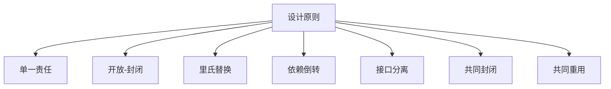

### 1. 知识点

| 原则 | 核心说法 | 题眼 |
|---|---|---|
| 单一责任原则 | 一个类仅有一个引起它变化的原因 | 一个类、一个变化原因 |
| 开放-封闭原则 | 软件实体对扩展开放，对修改关闭 | 可扩展、不可修改 |
| 里氏替换原则 | 基类对象出现的地方，子类对象一定可以出现 | 基类对象、子类对象 |
| 依赖倒转原则 | 依赖抽象，不依赖实现 | 高层不依赖底层、抽象不依赖细节 |
| 接口分离原则 | 不强迫客户依赖不用的方法 | 不用的方法、接口属于客户 |
| 共同封闭原则 | 包内类对同一类变化共同封闭 | 一个变化影响包中所有类 |
| 共同重用原则 | 重用包中一个类，就重用包中所有类 | 重用一个类，重用所有类 |

### 2. 关系图



### 3. 例题分析

**例 1**：高层模块不应该依赖底层模块，抽象不应该依赖细节，细节可以依赖抽象。  
题眼是“高层、底层、抽象、细节”，这是依赖倒转原则。若选项说“高层模块无法不依赖底层模块”，则错误。

**例 2**：软件实体可以扩展但不可修改。  
题眼是“扩展、修改”，答案为开放-封闭原则。

**例 3**：一个变化若对一个包产生影响，则将对包中所有类产生影响，而不影响其他包。  
题眼是“包、同一类性质的变化”，答案为共同封闭原则。

### 4. 记忆技巧

```text
单责一个因，开闭扩不改；
里氏子替父，倒转依抽象；
接口别强迫，封闭同变化；
重用要成包，一个用全用。
```
