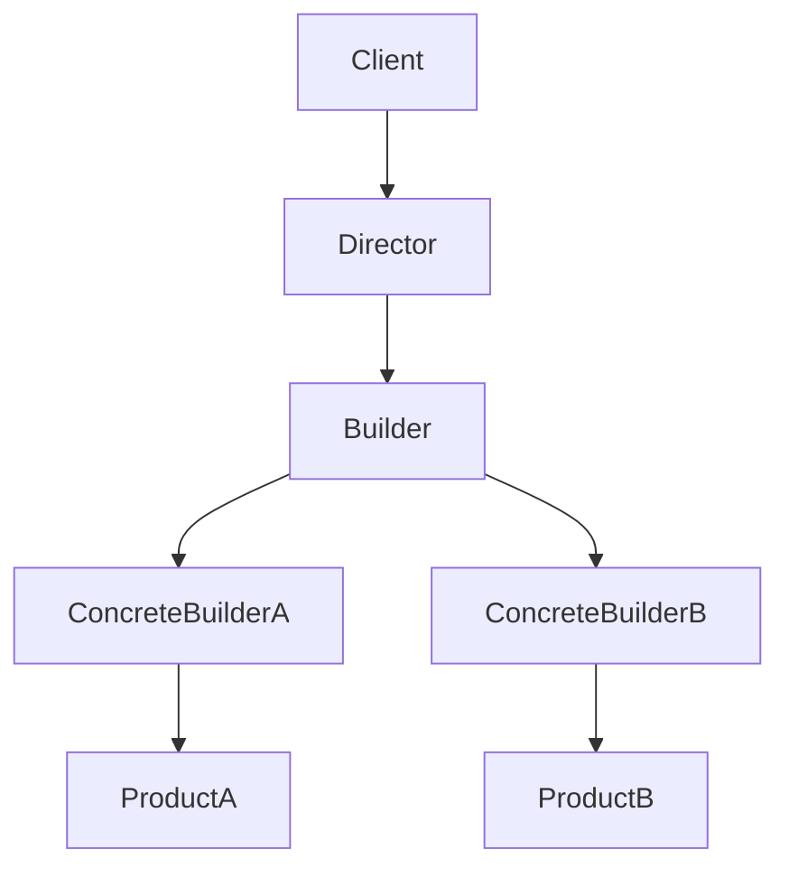
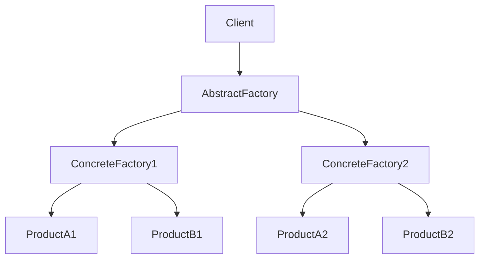

### 1. 知识点

| 模式 | 英文 | 核心意图 | 高频题眼 | 类型 |
|---|---|---|---|---|
| 工厂方法 | Factory Method | 定义创建对象接口，让子类决定实例化哪一个类 | “让子类决定创建哪个类” | 创建型类模式 |
| 抽象工厂 | Abstract Factory | 创建一系列相关或相互依赖对象的接口 | “产品族”“不同平台 GUI”“相关产品联合使用” | 创建型对象模式 |
| 生成器 | Builder | 复杂对象构建与表示分离 | “构建步骤相同，表示不同”“套餐、主餐、饮料、玩具” | 创建型对象模式 |
| 原型 | Prototype | 通过复制原型创建对象 | “复制对象”“克隆” | 创建型对象模式 |
| 单例 | Singleton | 保证一个类只有一个实例 | “唯一实例”“全局访问点” | 创建型对象模式 |

### 2. 创建型模式对比表

| 题目描述 | 优先考虑 | 为什么不是其他模式 |
|---|---|---|
| 一个系统要由多个产品系列中的一个来配置 | 抽象工厂 | 不是生成器，生成器强调复杂对象的构建步骤 |
| GUI 在 Windows、Linux、Mac 下有不同按钮、文本框、菜单 | 抽象工厂 | 同一产品族的一组相关产品 |
| 儿童套餐：主餐、饮料、玩具，制作过程相同，套餐表示不同 | 生成器 | 不是抽象工厂，因为重点不是产品族，而是构建过程 |
| 希望类 A 所有使用者都使用同一个实例 | 单例 | 不是 final/abstract；final 防继承，abstract 不能实例化 |
| 让子类决定实例化哪一个类 | 工厂方法 | 不是抽象工厂；抽象工厂通常是一族产品 |

### 3. 生成器模式结构图



### 4. 抽象工厂模式结构图



### 5. 例题分析

**例 1：GUI 多平台组件**  
题眼是“不同平台的并行类层次结构”。例如 WindowsButton、MacButton、WindowsTextBox、MacTextBox 属于不同产品族。系统需要一次性切换整套产品族。  
**结论**：抽象工厂。

**例 2：儿童套餐**  
题眼是“主餐、饮料、玩具”“制作过程相同”“餐品表示不同”“Waiter 调度厨师”。Waiter 相当于 Director，PizzaBuilder 相当于 Builder 接口，具体 Builder 负责不同套餐表示。  
**结论**：生成器。

**例 3：只有一个实例**  
题眼是“所有使用者都使用 A 的同一个实例”。这不是继承控制，而是实例控制。  
**结论**：单例。

### 6. 记忆技巧

```text
产品族找抽象工厂；
步骤同、表示异，找生成器；
子类决定创建谁，找工厂方法；
唯一实例，找单例；
复制克隆，找原型。
```
