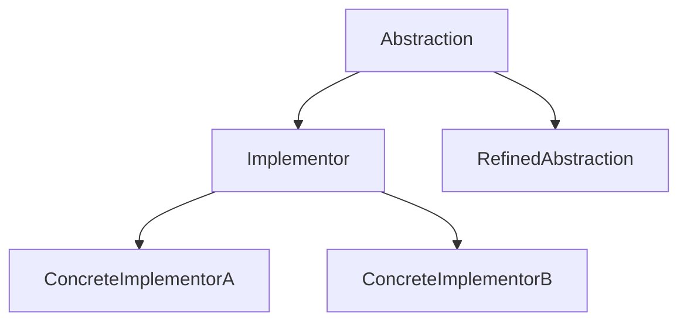
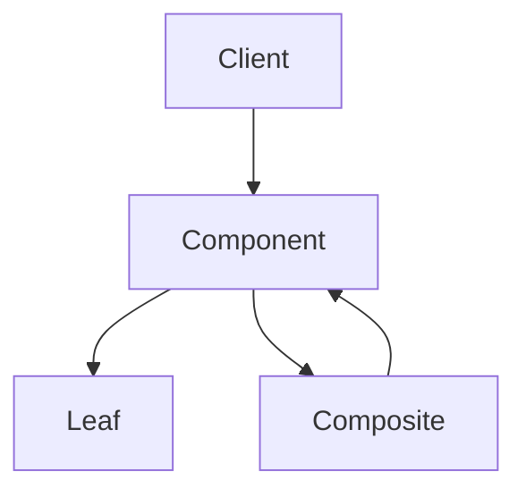

### 1. 知识点

| 模式 | 英文 | 核心意图 | 高频题眼 | 类型 |
|---|---|---|---|---|
| 适配器 | Adapter | 将一个类接口转换成客户希望的接口 | 接口不兼容、已有类接口不符合需求 | 结构型类/对象模式 |
| 桥接 | Bridge | 抽象部分与实现部分分离，使二者独立变化 | 两个维度独立扩展，如图形与绘制程序、Web 应用与主题 | 结构型对象模式 |
| 组合 | Composite | 树形结构表示部分—整体，统一处理叶子和组合 | 部分整体、树形结构、一致性 | 结构型对象模式 |
| 装饰器 | Decorator | 动态给对象添加职责 | 不用子类扩展、动态添加功能 | 结构型对象模式 |
| 外观 | Facade | 为复杂子系统提供简单接口 | 简化接口、统一入口、复杂子系统 | 结构型对象模式 |
| 享元 | Flyweight | 共享大量细粒度对象，降低内存开销 | 大量对象、存储开销、共享技术 | 结构型对象模式 |
| 代理 | Proxy | 为对象提供代理以控制访问 | 控制访问、远程代理、保护代理、虚代理 | 结构型对象模式 |

### 2. 结构型模式易混对照

| 易混组 | 模式 | 包装对象数量 | 目的 | 题眼 |
|---|---|---:|---|---|
| 包装类模式 | 适配器 | 包装一个已有对象 | 转换接口 | “接口不符合需求” |
| 包装类模式 | 装饰器 | 包装一个对象 | 添加额外行为 | “动态添加职责” |
| 包装类模式 | 代理 | 包装一个对象 | 控制访问 | “控制对对象的访问” |
| 包装类模式 | 外观 | 包装一系列对象 | 简化复杂子系统接口 | “为复杂子系统提供简单接口” |
| 结构扩展 | 桥接 | 抽象和实现两条继承线 | 两个维度独立变化 | “抽象部分与实现部分分离” |
| 结构扩展 | 组合 | 叶子和容器统一 | 部分—整体层次 | “树形结构，一致使用” |
| 性能优化 | 享元 | 共享对象 | 减少大量对象开销 | “大量细粒度对象” |

### 3. 桥接模式结构图



### 4. 组合模式结构图



### 5. 例题分析

**例 1：接口不兼容**  
题眼是“将一个类的接口转换成客户希望的另外一个接口”。  
**结论**：适配器。

**例 2：Web 应用和主题样式**  
一个维度是 WebApplication，可以有 Blog、News、Shop；另一个维度是 Theme，可以有 Light、Dark。两个维度都可能变化。  
**结论**：桥接。

**例 3：文件夹与文件、公司与部门**  
题眼是“部分—整体”“树形结构”“单个对象和组合对象一致使用”。  
**结论**：组合。

**例 4：给对象动态添加职责**  
题眼是“动态地给一个对象添加额外职责”，且“不适合用子类扩展”。  
**结论**：装饰器。

**例 5：复杂子系统统一入口**  
题眼是“需要为复杂子系统提供一个简单接口”。  
**结论**：外观。

### 6. 记忆技巧

```text
接口不合找适配，两个维度找桥接；
部分整体用组合，动态加责装饰器；
复杂系统用外观，大量对象用享元；
控制访问找代理。
```
