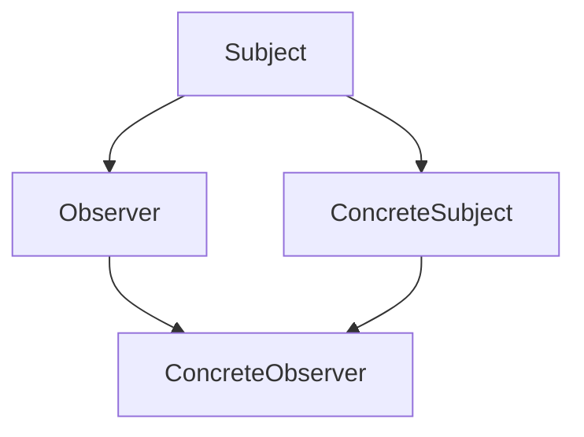
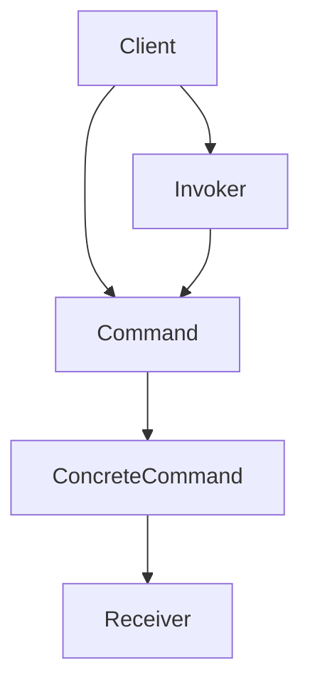
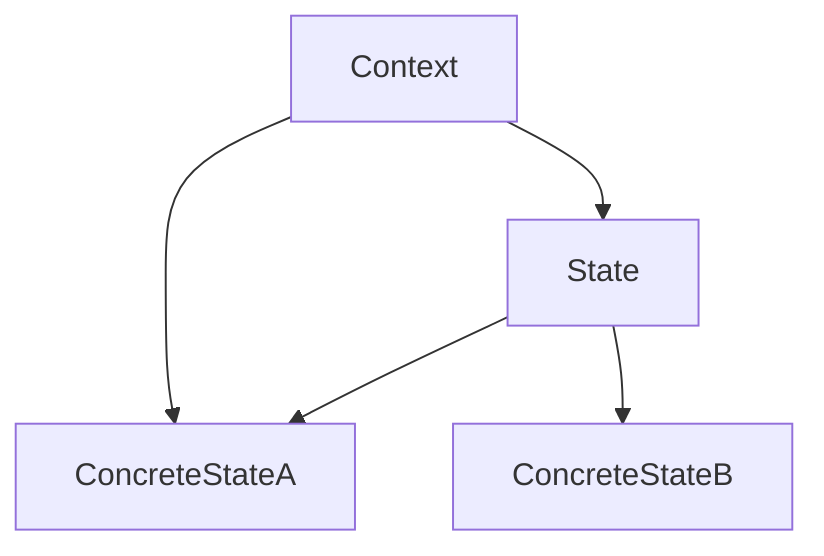

### 1. 知识点

| 模式 | 英文 | 核心意图 | 高频题眼 | 类型 |
|---|---|---|---|---|
| 责任链 | Chain of Responsibility | 多个对象都有机会处理请求，沿链传递 | 请求沿链传递，直到被处理 | 行为型对象模式 |
| 命令 | Command | 将请求封装为对象 | 请求参数化、排队、日志、撤销 | 行为型对象模式 |
| 解释器 | Interpreter | 为语言定义文法并解释句子 | 抽象语法树、解释执行 | 行为型类模式 |
| 迭代器 | Iterator | 顺序访问聚合对象元素且不暴露内部表示 | 遍历集合、访问聚合对象 | 行为型对象模式 |
| 中介者 | Mediator | 用中介对象封装一系列对象交互 | 网状通信复杂、降低耦合 | 行为型对象模式 |
| 备忘录 | Memento | 保存并恢复对象内部状态 | 恢复到先前状态、撤销状态 | 行为型对象模式 |
| 观察者 | Observer | 一对多依赖，对象改变时通知依赖者 | 发布订阅、监听者、自动通知 | 行为型对象模式 |
| 状态 | State | 对象内部状态改变时改变行为 | 状态决定行为，看起来像改变类 | 行为型对象模式 |
| 策略 | Strategy | 封装一系列算法并可互换 | 打折、返利、满减；算法变体 | 行为型对象模式 |
| 模板方法 | Template Method | 在父类定义算法骨架，子类实现步骤 | 算法骨架固定，步骤可变 | 行为型类模式 |
| 访问者 | Visitor | 对对象结构增加很多不相关操作 | `accept(visitor)`、对象结构稳定、操作变化 | 行为型对象模式 |

### 2. 行为型模式易混对照

| 易混组 | 模式 | 核心区别 | 题眼 |
|---|---|---|---|
| 行为变化 | 策略 | 算法可替换，通常由客户选择策略 | 打折、返利、满减、算法变体 |
| 行为变化 | 状态 | 行为由对象内部状态决定，运行时随状态变化 | 库存、金额、连接状态、登录次数 |
| 通知协作 | 观察者 | 一个主题通知多个观察者 | 发布订阅、一对多依赖 |
| 通知协作 | 中介者 | 中介对象集中管理多对象交互 | 网状依赖混乱、对象不直接引用 |
| 请求处理 | 命令 | 请求封装为对象，可撤销、排队、日志 | 买入/卖出命令、Operation 接口 |
| 请求处理 | 责任链 | 多个对象沿链处理请求 | 多个处理者、传递请求直到处理 |
| 遍历与扩展 | 迭代器 | 遍历聚合对象元素 | 顺序访问、不暴露内部结构 |
| 遍历与扩展 | 访问者 | 对对象结构增加操作 | accept 方法，Visitor 作为参数 |

### 3. 观察者模式结构图



### 4. 命令模式结构图



### 5. 状态模式结构图



### 6. 例题分析

**例 1：股票买卖操作**  
题眼是“将请求封装为对象”“对请求排队或记录日志”“支持撤销”。BuyOperation、SellOperation 等是具体命令，Operation 是命令接口。  
**结论**：命令模式。

**例 2：用户组与权限映射**  
题眼是“用户和组之间关系复杂，由映射维护”“对象不需要显式互相引用”“耦合松散”。  
**结论**：中介者模式。

**例 3：发布—订阅消息模型**  
题眼是“订阅主题”“有新消息时所有订阅者收到通知”。  
**结论**：观察者模式。

**例 4：自动售货机**  
题眼是“库存、金额、找零能力、所选项目不同，行为不同”。行为由内部状态决定。  
**结论**：状态模式。

**例 5：打折、返利、满减促销**  
题眼是“不同时期不同促销算法”“算法可替换”。  
**结论**：策略模式。

**例 6：购物车商品结账，人工或自动计算总价**  
题眼是“对对象结构中的对象进行很多不同操作”“accept 方法以 Visitor 为参数”。  
**结论**：访问者模式。

### 7. 记忆技巧

```text
请求对象化是命令，复杂通信找中介；
一改多通知观察者，状态变行为是状态；
算法替换用策略，遍历聚合迭代器；
accept传Visitor，新增操作访问者。
```
