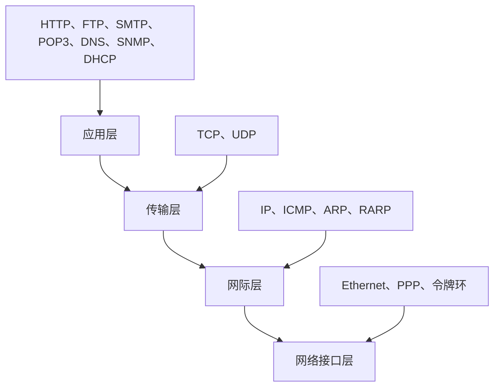

### 1. 知识点

| 模型 | 层次 | 主要功能 | 考试判断方式 |
|---|---|---|---|
| OSI 七层 | 应用层 | 面向具体应用服务 | HTTP、FTP、SMTP、POP3、DNS、SNMP 等多归到这里 |
| OSI 七层 | 表示层 | 数据表示、加密、压缩、格式转换 | 上午题较少直接考 |
| OSI 七层 | 会话层 | 会话建立、管理、释放 | 常作为干扰项 |
| OSI 七层 | 传输层 | 端到端通信、端口寻址、可靠传输 | TCP、UDP 位于传输层 |
| OSI 七层 | 网络层 | 路由选择、逻辑地址、分组转发 | IP、ICMP、ARP、RARP、路由器 |
| OSI 七层 | 数据链路层 | 成帧、MAC 地址、差错检测、介质访问 | 交换机、网桥、以太网帧 |
| OSI 七层 | 物理层 | 比特传输、电气机械特性 | 中继器、集线器 |
| TCP/IP 模型 | 应用层 | 合并 OSI 应用层、表示层、会话层 | FTP、HTTP、SMTP 等 |
| TCP/IP 模型 | 传输层 | TCP、UDP | 端口和端到端进程通信 |
| TCP/IP 模型 | 网际层 | IP、ICMP、ARP、RARP | 网络间寻址和转发 |
| TCP/IP 模型 | 网络接口层 | 以太网、令牌环、PPP 等 | 负责把 IP 数据报发到物理网络 |

### 2. 文字讲解

计算机网络题最忌讳“看到协议就孤立背”。分层模型的价值在于：每一层只解决一类问题。物理层只管比特能不能传出去，不理解 MAC 地址和 IP 地址；数据链路层开始处理同一链路上的帧和 MAC；网络层解决跨网络转发，所以路由器、IP、ICMP、ARP 常落在这一层；传输层面向进程通信，所以一出现“端口”“三次握手”“可靠传输”，就应想到 TCP 或 UDP；应用层则是直接为用户应用服务，如网页、邮件、文件传输、域名解析、网络管理。

OSI 七层模型在考试中常用来考“对应关系”。TCP/IP 模型则更贴近实际协议簇。题目若问“TCP/IP 协议栈中某协议属于哪一层”，不要机械套 OSI 七层，而应按 TCP/IP 四层理解：TCP/UDP 是传输层，IP/ICMP/ARP/RARP 是网际层，FTP/HTTP/SMTP/POP3/DNS/DHCP/SNMP 多数按应用层处理。

### 3. 协议层次图



### 4. 例题分析

#### 例 1：ICMP 属于哪一层，封装在哪里

**题眼**：ICMP 是“因特网控制报文协议”，用于网络控制和差错报告。  
**套知识点**：ICMP 属于 TCP/IP 的网际层，ICMP 报文封装在 IP 数据报中传送。  
**结论**：层次选网络层，封装选 IP 数据报。

#### 例 2：SNMP 属于应用层还是网络层

**题眼**：SNMP 是简单网络管理协议，虽然管理网络设备，但它是应用层协议。  
**套知识点**：SNMP 通常使用 UDP 封装，常见端口 161。  
**结论**：SNMP 属于应用层，传输层多选 UDP。

### 5. 记忆技巧

```text
层次判断三步走：
看设备：集线中继物理层，网桥交换链路层，路由器在网络层。
看协议：IP/ICMP/ARP在网际层，TCP/UDP在传输层，其余常用服务多在应用层。
看功能：端口是传输层，路由是网络层，MAC是数据链路层，比特是物理层。
```
