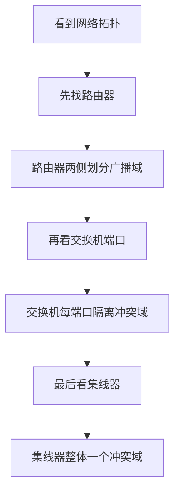

### 1. 知识点

| 设备 | 所在层 | 作用 | 是否隔离冲突域 | 是否隔离广播域 | 常见题眼 |
|---|---|---|---|---|---|
| 中继器 | 物理层 | 放大、再生信号 | 否 | 否 | 物理层设备 |
| 集线器 | 物理层 | 多端口中继器 | 否 | 否 | 所有端口一个冲突域 |
| 网桥 | 数据链路层 | 根据 MAC 地址转发帧 | 是 | 否 | 数据链路层设备 |
| 交换机 | 数据链路层 | 多端口网桥 | 是 | 否 | 每端口一个冲突域 |
| 路由器 | 网络层 | 根据 IP 地址转发分组 | 是 | 是 | 划分广播域 |
| 网关 | 应用层常考 | 协议转换 | 视情况 | 视情况 | 异构网络互联 |

### 2. 文字讲解

网络设备题的核心不是背设备名称，而是理解“设备看到的数据单位”。集线器只在物理层工作，它看到的是电信号或比特流，不认识帧地址，也不会智能转发。因此，集线器收到一个端口的数据后会向其他端口扩散，所有端口仍处在同一个冲突域和广播域内。交换机工作在数据链路层，能够识别 MAC 地址，知道某个 MAC 地址在哪个端口上，因此可把不同端口的冲突隔离开。可是广播帧仍会被交换机转发到同一 VLAN 内的其他端口，所以普通交换机不隔离广播域。路由器工作在网络层，按 IP 网络转发，它不会转发二层广播，因此路由器可以隔离广播域。

很多题会把“交换机是一种多端口网桥”和“集线器是一种多端口中继器”放在一起考。二者形式上都多端口，但层次完全不同：集线器不自动寻址，交换机会学习 MAC 地址；集线器下所有主机争用同一冲突域，交换机每个端口形成独立冲突域。

### 3. 冲突域与广播域判断流程



### 4. 例题分析

#### 例 1：物理层设备与网络层设备

**题眼**：问“属于物理层”和“属于网络层”。  
**套知识点**：中继器、集线器属于物理层；路由器属于网络层；交换机、网桥属于数据链路层。  
**结论**：物理层选中继器，网络层选路由器。

#### 例 2：集线器与交换机描述错误项

**题眼**：题目问“错误的是”。  
**套知识点**：交换机是多端口网桥；交换机所有端口默认在一个广播域；集线器所有端口组成一个冲突域；集线器不能自动寻址。  
**结论**：“集线器可以起到自动寻址的作用”错误。

### 5. 记忆技巧

```text
集线器：傻转发，不寻址，不隔离。
交换机：看MAC，隔冲突，不隔广播。
路由器：看IP，隔冲突，也隔广播。
```
