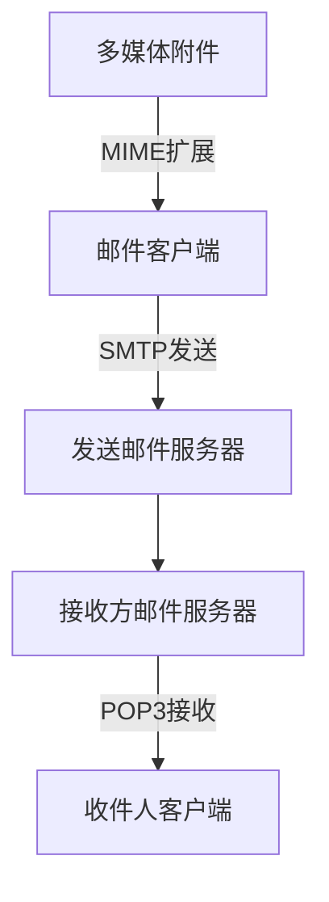

### 1. 知识点

| 协议 | 功能 | 端口 | 传输层 | 常见题眼 |
|---|---|---|---|---|
| SMTP | 发送邮件 | 25 | TCP | 客户端向服务器发送邮件、邮件发送服务器 |
| POP3 | 接收邮件 | 110 | TCP | 从服务器取邮件、C/S 模式 |
| IMAP4 | 接收和管理邮件 | 常见 143 | TCP | 服务器端管理邮件 |
| MIME | 多媒体邮件扩展 | 非端口协议 | 依附邮件体系 | 附件、图片、音频、非 ASCII 内容 |

### 2. 文字讲解

邮件协议题常把 SMTP、POP3、MIME 放在一起干扰。SMTP 是“发”，POP3 是“收”，MIME 不是用来建立连接的邮件收发协议，而是对邮件内容格式进行扩展，使邮件能够携带多媒体附件。SMTP 原本主要传输 ASCII 文本，若要发送图片、音频等附件，就需要 MIME 支持。

若题目说“服务器只开放 25 和 110 两个端口”，25 对应 SMTP，110 对应 POP3，因此该服务器可以提供电子邮件服务。若问“客户与 POP3 服务器建立什么连接”，要选 TCP，因为 POP3 运行在 TCP 之上。

### 3. 邮件发送与接收流程



### 4. 例题分析

#### 例 1：POP3 默认 TCP 端口号

**题眼**：POP3、默认端口。  
**套知识点**：POP3 是接收邮件协议，使用 TCP 110 端口。  
**结论**：110。

#### 例 2：发送邮件附加多媒体数据

**题眼**：附加多媒体数据。  
**套知识点**：SMTP 负责发送邮件，但多媒体附件需要 MIME 扩展支持。  
**结论**：选 MIME。

### 5. 记忆技巧

```text
SMTP：S 可记 Send，发邮件，25。
POP3：P 可记 Pick up，取邮件，110。
MIME：M 可记 Multimedia，多媒体附件。
```
