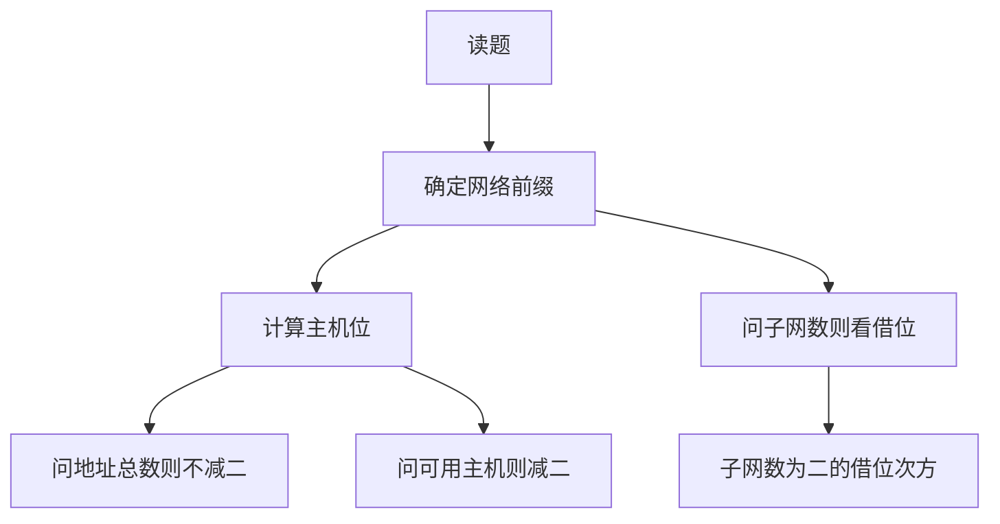

### 1. 知识点

| 概念 | 说明 | 做题公式 |
|---|---|---|
| IPv4 地址 | 32 位，四段十进制，每段 8 位 | 每段范围 0～255 |
| 子网掩码 | 网络号为 1，主机号为 0 | `/n` 表示前 n 位为网络位 |
| 主机位数 | $32-n$ | 斜杠记法 `/n` |
| 地址总数 | $2^{主机位数}$ | 包括网络地址和广播地址 |
| 可用主机数 | $2^{主机位数}-2$ | 通常主机位全 0 和全 1 不可用 |
| 子网数 | $2^{借位数}$ | 从原主机位借几位作子网号 |
| C 类子网个数 | 地址块大小除以 256 | `/20` 到 `/24` 差 4 位，故 $2^4=16$ |
| 最长前缀匹配 | 多条路由可匹配时选网络前缀最长者 | `/26` 优先于 `/22` |

### 2. 文字讲解

子网划分题应先把题目转换为“网络位和主机位”。例如 `/26` 表示网络位 26 位，主机位 $32-26=6$ 位，地址总数 $2^6=64$，可用主机数 $64-2=62$。若题目问“一个 B 类网络使用 255.255.224.0 掩码划分成几个子网”，B 类默认网络位是 16 位，而 255.255.224.0 的二进制网络位为 19 位，因此从原主机位借了 3 位作子网号，子网数为 $2^3=8$。

路由匹配题要用“最长前缀匹配”。所谓最长前缀，并不是看选项地址数值最接近，而是看哪一条路由的网络前缀与目的地址匹配，并且前缀长度最长。若某地址与 `/22` 路由匹配，就要看第三段按块大小 4 对齐；若是 `/26`，第四段按块大小 64 对齐。块大小计算方法是：某段掩码值为 $m$，块大小为 $256-m$。

### 3. 子网计算模板

$$
主机位数 = 32 - 网络前缀长度
$$

$$
地址总数 = 2^{主机位数}
$$

$$
可用主机数 = 2^{主机位数} - 2
$$

$$
子网数 = 2^{借用的主机位数}
$$

### 4. 子网划分流程



### 5. 例题分析

#### 例 1：222.125.80.128/26 包含多少可用主机地址

**题眼**：`/26`、可用主机地址。  
**套知识点**：主机位 $32-26=6$，地址总数 $2^6=64$，可用主机数 $64-2=62$。  
**结论**：62 个可用主机地址。

#### 例 2：210.115.192.0/20 可以划分为几个 C 类子网

**题眼**：`/20` 地址块、C 类子网。  
**套知识点**：C 类网络前缀是 `/24`。从 `/20` 到 `/24` 多出 4 位，因此可划分 $2^4=16$ 个 C 类子网。  
**结论**：16。

### 6. 记忆技巧

```text
斜杠后是网络位，32减它是主机位。
问总数不减二，问可用要减二。
问子网看借位，借几位就是二的几次方。
```
