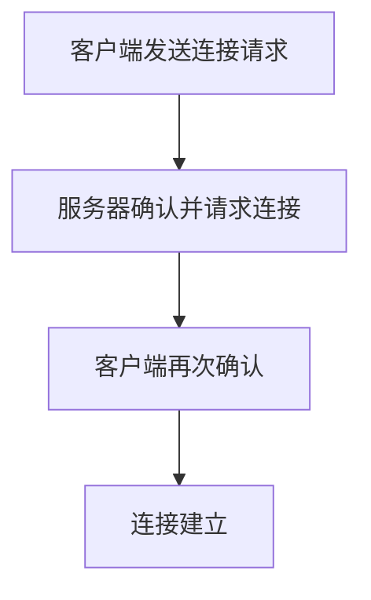

### 1. 知识点

| 对比项 | TCP | UDP |
|---|---|---|
| 连接方式 | 面向连接 | 无连接 |
| 可靠性 | 可靠传输 | 不可靠传输 |
| 建立连接 | 三次握手 | 不建立连接 |
| 流量控制 | 有，可变大小滑动窗口 | 无 |
| 拥塞控制 | 有 | 无 |
| 差错处理 | 差错校验和重传 | 有校验但不保证重传 |
| 首部开销 | 20B 起 | 8B |
| 适用场景 | 文件传输、网页、邮件等 | VoIP、视频、DNS、DHCP、SNMP 等 |
| 共同点 | 都属于传输层，都提供端口寻址 | 都属于传输层，都提供端口寻址 |

### 2. 文字讲解

TCP 的关键词是“可靠”。可靠不是靠一个机制完成的，而是连接管理、确认、重传、流量控制、拥塞控制等共同保证的。考试中出现“三次握手”“可靠通信”“可变大小滑动窗口”，优先选 TCP。UDP 的关键词是“简单、快、开销小”。它不保证可靠传输，因此更适合实时语音、视频、简单请求响应等场景。VoIP 一般选 UDP，因为语音通信更重视实时性，个别语音包丢失比大延迟更可接受。

TCP 和 UDP 的共同点也常考：二者都在传输层，都通过端口号区分不同应用进程。因此“端口寻址”是共同能力；“连接管理、差错校验和重传、流量控制、拥塞控制”则不能说是 UDP 也提供。

### 3. 三次握手简图



### 4. 例题分析

#### 例 1：TCP 属于哪一层，几次握手

**题眼**：TCP、建立连接。  
**套知识点**：TCP 属于传输层，通过三次握手建立连接。  
**结论**：传输层，3 次。

#### 例 2：TCP 和 UDP 均提供什么能力

**题眼**：问共同能力。  
**套知识点**：UDP 没有连接管理、重传、流量控制，但 TCP 和 UDP 都通过端口识别应用进程。  
**结论**：端口寻址。

### 5. 记忆技巧

```text
TCP：连得上、传得稳、管得多、开销大。
UDP：不连接、不保证、速度快、开销小。
共同点：都在传输层，都有端口号。
```
