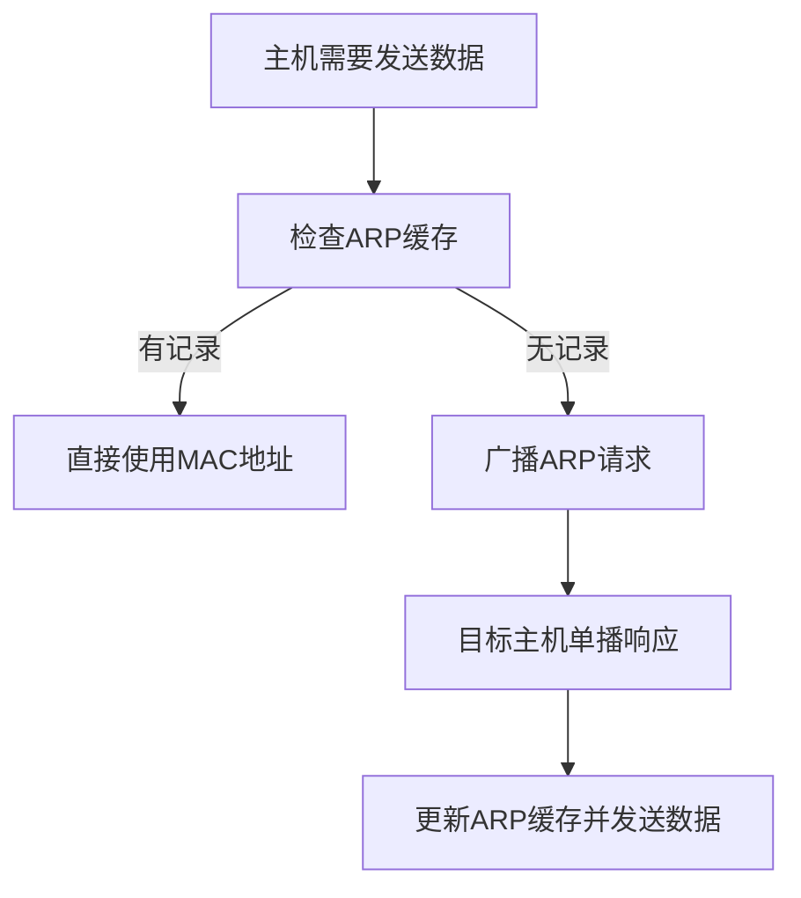

### 1. 知识点

| 协议 | 功能 | 关键过程 | 常见答案方向 |
|---|---|---|---|
| ARP | IP 地址转换为 MAC 地址 | Request 广播，Response 单播 | IP 到 MAC |
| RARP | MAC 地址转换为 IP 地址 | 反向地址解析 | MAC 到 IP |
| DHCP | 动态分配 IP 地址等配置 | 客户机向服务器申请租约 | 自动分配 IP、网关、DNS |

### 2. 文字讲解

ARP 的实质是解决“知道对方 IP，但不知道对方网卡 MAC 地址”的问题。主机先查本地 ARP 缓存，若没有对应项，就在局域网内广播 ARP Request。拥有该 IP 的主机收到请求后，用单播方式返回 ARP Response，其中包含自己的 MAC 地址。所以题目常考“ARP Request 广播、ARP Response 单播”。

DHCP 解决的是“主机自动获得网络配置”的问题。DHCP 分配的不仅是 IP 地址，还可能包括默认网关、DNS 服务器地址、DHCP 服务器地址等。若 Windows 主机没有从 DHCP 服务器获得地址，常会自动获得 169.254.X.X 这样的地址，这类地址表示自动私有地址，通常说明 DHCP 租约获取失败。

### 3. ARP 工作流程



### 4. 例题分析

#### 例 1：ARP 的作用

**题眼**：ARP 协议作用。  
**套知识点**：ARP 是 Address Resolution Protocol，完成 IP 地址到 MAC 地址的解析。  
**结论**：实现 IP 地址与 MAC 地址之间的变换。

#### 例 2：DHCP 获取失败后的地址

**题眼**：开机后没有得到 DHCP 服务器响应。  
**套知识点**：Windows 自动私有地址常为 169.254.X.X。  
**结论**：选择 169.254.0.0/16。

### 5. 记忆技巧

```text
ARP：IP找MAC，请求广播，响应单播。
RARP：MAC找IP，反过来。
DHCP：自动发地址，失败看169.254。
```
