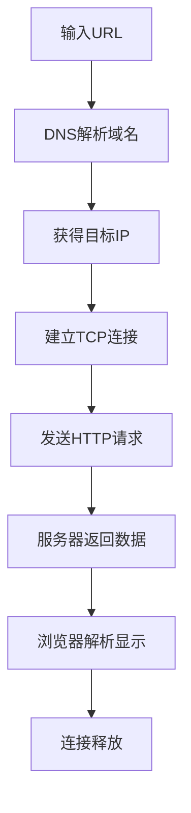

### 1. 知识点

| 内容     | 说明                          | 考试题眼                         |
| ------ | --------------------------- | ---------------------------- |
| URL 格式 | `协议://主机域名/路径/文件名`          | 协议、主机名、域名、路径、文件名             |
| 主机名    | 域名前最左侧的主机标识                 | `www.abc.com` 中 `www`        |
| 域名     | 主机所在的域                      | `abc.com`、`dailynews.com.cn` |
| 文件名    | URL 最后一段资源名                 | `welcome.html`               |
| 默认协议   | 浏览器地址栏直接输入域名，默认 HTTP        | `www.abc.com` 默认 HTTP        |
| 顶级域    | com、edu、gov、net、org、cn、uk 等 | uk、cn 属于国家或地区顶级域             |
| 无痕浏览   | 不保存浏览历史等，但下载文件仍在磁盘          | “依然会保存”常选下载文件                |

### 2. 文字讲解

URL 题的关键是从左到右拆分。`http://www.dailynews.com.cn/channel/welcome.html` 中，`http` 是协议类型，`www.dailynews.com.cn` 是主机域名，`channel` 是路径或目录，`welcome.html` 是网页文件名。若题目只给 `wb.xyz.com.cn` 并问 `wb` 是什么，`wb` 位于最左侧，一般是主机名。

域名系统是层次结构。`com`、`edu`、`gov`、`net`、`org` 多属于组织类顶级域；`cn`、`uk`、`us`、`jp` 等属于国家或地区顶级域。注意大小写不改变域名本质，题目选项中 `UK` 仍可视为国家顶级域。

浏览器访问网页时，一般先输入 URL，再进行域名解析，得到 IP 后建立 TCP 连接，然后发送 HTTP 请求，服务器返回网页数据，浏览器解析显示，最后连接关闭。某些教材或题目将“断开连接”放在“显示页面”之前，是因为浏览器收到完整数据后可以先释放连接，再解析显示；做题时应以题目给出的标准选项为准。

### 3. HTTP 请求过程



### 4. 例题分析

#### 例 1：URL 中的主机名

**题眼**：`wb.xyz.com.cn` 中 `wb` 是什么。  
**套知识点**：最左侧通常是主机名，后面是域名层次。  
**结论**：`wb` 是主机名。

#### 例 2：国家顶级域

**题眼**：哪个顶级域属于国家顶级域。  
**套知识点**：`COM`、`EDU`、`NET` 是组织类；`UK` 是英国国家或地区顶级域。  
**结论**：UK。

### 5. 记忆技巧

```text
URL拆分：协议看冒号，主机看双斜杠后，文件看最后一段。
顶级域：com商业，edu教育，gov政府，net网络，org组织；cn中国，uk英国，jp日本。
```
