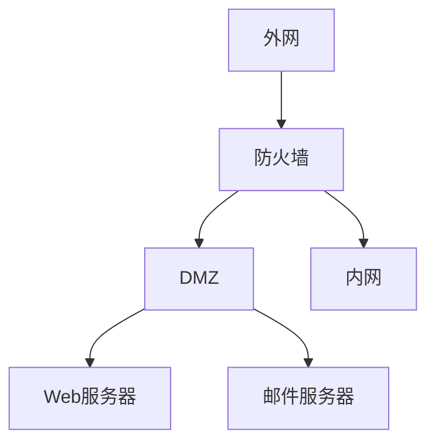

### 1. 知识点

| 类型 | 工作层次 | 核心特点 | 常考题眼 | 考试答案方向 |
|---|---|---|---|---|
| 包过滤防火墙 | 网络层为主 | 检查源/目的 IP、端口、协议；对用户透明；速度快 | “包过滤”“网络层”“透明” | 不看 MAC，不查毒，不做漏洞扫描 |
| 应用级网关防火墙 | 应用层 | 可检查应用层通信，安全性较高，但效率较低 | “应用层监控和过滤” | 应用级网关 |
| 状态检测防火墙 | 网络层/传输层状态 | 兼顾包过滤速度与代理安全性 | “状态”“连接状态” | 状态检测 |
| DMZ | 网络边界隔离区 | 放置对外公开服务器 | “Web服务器”“公共服务器” | Web 放 DMZ |

### 2. 模板

```text
防火墙保护程度：
内网 > DMZ > 外网

如果题目问“从高到低”：
内网 → DMZ → 外网

如果题目问“从低到高”：
外网 → DMZ → 内网
```



### 3. 例题分析

#### 例 1：包过滤依据

包过滤防火墙检查的是 IP 数据包头部中的字段，如源 IP、目的 IP、源端口、目的端口和协议类型。MAC 地址属于链路层地址，不是包过滤防火墙最典型的过滤依据。

| 题眼 | 判断 |
|---|---|
| 源 IP 地址 | 可以过滤 |
| 源端口号 | 可以过滤 |
| 目的 IP 地址 | 可以过滤 |
| MAC 地址 | 不是典型依据 |

**结论：看到“包过滤依据不包括”，优先选 MAC 地址。**

#### 例 2：防火墙不能做什么

防火墙能做访问控制、包过滤、代理、日志审计，也能隐藏内部网络结构。但防火墙不是杀毒软件，也不是漏洞扫描器。

| 功能 | 防火墙是否具备 |
|---|---|
| 包过滤 | 是 |
| 代理 | 是 |
| 记录访问过程 | 是 |
| 查毒 | 否 |
| 漏洞扫描 | 否 |

### 4. 记忆技巧

```text
包过滤：看地址、看端口、看协议。
代理墙：看应用，安全高，速度慢。
DMZ：公共服务放中间。
防火墙：能挡门，不能治病，不能体检。
```
