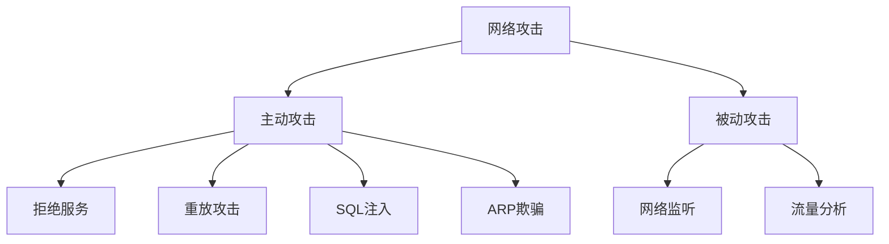

### 1. 知识点

| 攻击方式 | 题眼 | 作用 / 目标 | 答案方向 |
|---|---|---|---|
| DoS | 大量请求耗尽资源 | 使系统不能提供服务 | 拒绝服务 |
| DDoS | 多个来源同时攻击 | 分布式拒绝服务 | DDoS |
| SYN Flooding | 大量半连接 | 典型 DoS | SYN Flooding |
| ARP攻击 | 伪造网关 ARP | 数据包不能发到网关 | 网关 ARP 被伪造 |
| 重放攻击 | 发送已接受过的报文 | 破坏认证正确性 | 重放 |
| SQL注入 | 提交数据库查询片段 | 获取数据库权限 | 数据库权限 |
| 网络监听 | 截获通信内容 | 窃听账号、口令 | 数据加密防范 |
| 端口扫描 | 检测开放端口 | 判断远程主机状态 | 端口扫描 |

### 2. 主动攻击与被动攻击

| 类型 | 特点 | 例子 |
|---|---|---|
| 主动攻击 | 会改变系统状态或影响服务 | DoS、重放、篡改、欺骗 |
| 被动攻击 | 主要是窃听和收集信息 | 网络监听、流量分析 |

### 3. Mermaid 关系图



### 4. 记忆技巧

```text
请求打爆是DoS。
老包重发是重放。
假冒网关是ARP。
查开放口是端扫。
拼SQL是注入。
偷听链路靠加密。
```
