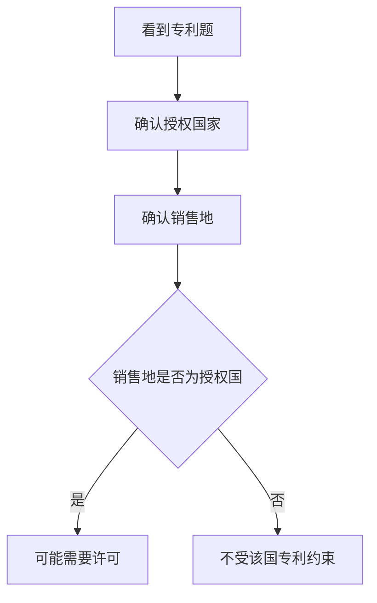

### 1. 知识点

| 判断点 | 结论 | 例子 |
|---|---|---|
| 专利只在授权国有效 | 具有地域性 | 美国专利只在美国受保护 |
| 未在中国申请 | 在中国不享有中国专利保护 | 在中国销售不因该美国专利付费 |
| 返销授权国 | 可能落入授权国专利保护 | 返销美国要考虑美国专利许可 |

### 2. 流程图



### 3. 例题分析

**例 1**：美国专利未在中国申请，在中国销售是否需要支付美国专利许可费？  
答案方向：不需要。因为美国专利不自动在中国生效。

### 4. 记忆技巧

```text
专利有国界，授权在哪国，保护在哪国。
```
