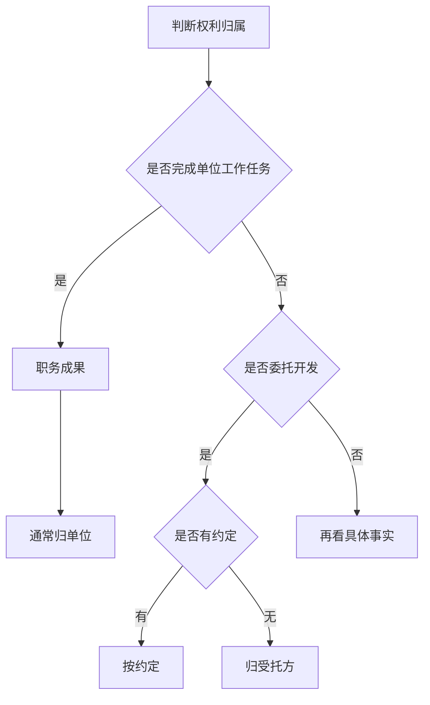

### 1. 知识点

| 类型 | 题眼 | 权利归属 | 常见干扰 |
|---|---|---|---|
| 职务软件/文档 | 任职期间、完成公司任务、按公司规定、归档 | 公司/单位 | “独立完成”“业余时间”“实习身份” |
| 职务发明 | 为完成单位交给的工作任务 | 任务单位 | “兼职”“业余时间” |
| 委托开发 | A接受B委托开发 | 有约定从约定；无约定归受托方 | “委托方出钱所以归委托方” |
| 利用单位物质技术条件 | 实验室、材料、未公开资料 | 原则归单位，有特别约定从约定 | “一定归个人/一定归单位”绝对化选项 |

### 2. 流程图



### 3. 例题分析

**例 1**：程序员按公司规定编写软件文档并归档。  
题眼是“按公司规定、归档”。结论：职务作品，著作权归公司。

**例 2**：甲公司受乙公司委托开发软件，无合同约定。  
题眼是“委托开发、无约定”。结论：著作权归受托方甲公司。

### 4. 记忆技巧

```text
公司任务归公司，委托无约归受托；
业余兼职别迷惑，关键要看谁交活。
```
