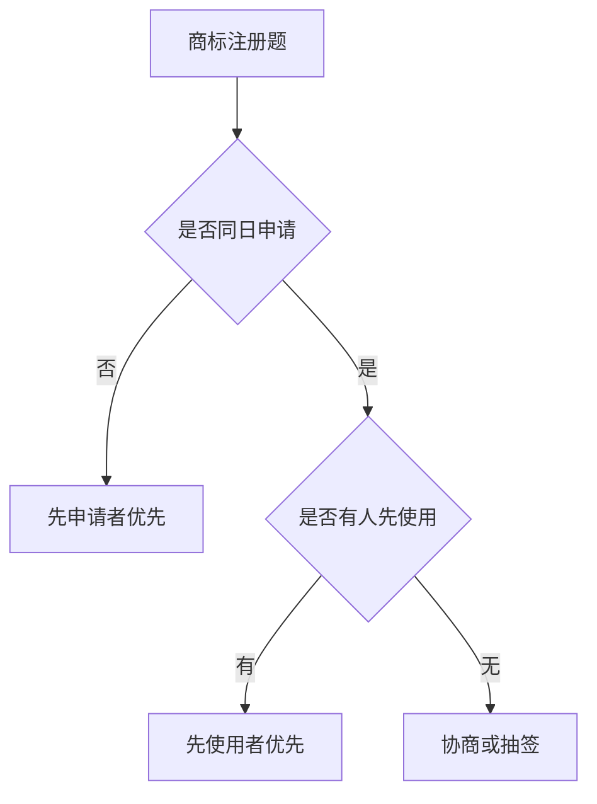

### 1. 知识点

| 考点       | 规则              | 易错点             |
| -------- | --------------- | --------------- |
| 商标权人     | 注册商标所有人         | 不是设计人、制作人、普通使用人 |
| 保护期限     | 可续展             | 因续展可能无限期拥有      |
| 同日申请     | 先使用者优先          | 比专利多一个“先使用”判断   |
| 同日且均未使用  | 协商或抽签           | 不能都注册近似商标       |
| 必须注册商标商品 | 烟草制品等           | 软件题中常作杂题出现      |
| 地名商标     | 县级以上行政区划地名一般不得用 | 有其他含义可能例外       |

### 2. 商标注册判断流程



### 3. 例题分析

**例 1**：甲乙同日申请近似商标，乙先使用。  
结论：乙获准注册。

**例 2**：甲乙同日申请相同商标，双方均未使用。  
结论：协商或抽签确定。

### 4. 记忆技巧

```text
商标先申请，同日看先用；
都没用抽签，续展可长久。
```
