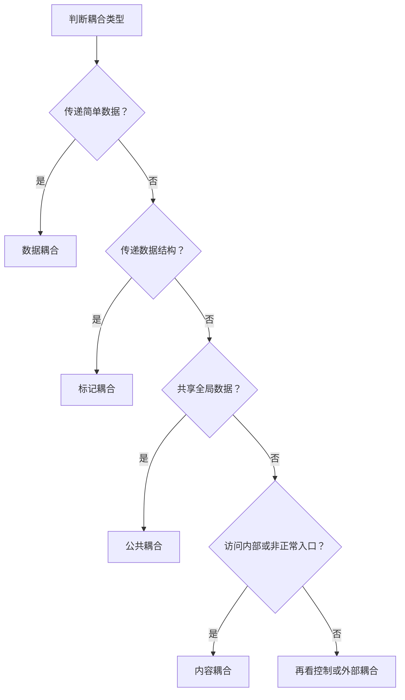

### 1. 知识点

耦合是模块之间相互连接紧密程度的度量。做题时不要先想“是不是两个模块有关系”，而要看**模块之间传递了什么、共享了什么、有没有直接闯入内部**。

| 耦合类型 | 题眼 | 典型例子 | 做题落点 |
|---|---|---|---|
| 数据耦合 | 传递简单数据项 | 金额、日期、数量、平均成绩 | 简单参数，耦合较低 |
| 标记耦合 | 传递数据结构 | 学生结构体、记录、表、结构 X | 传一整个结构，不是单个字段 |
| 控制耦合 | 传递控制信号 | 参数决定模块执行哪个分支 | “控制变量”“选择功能” |
| 外部耦合 | 依赖外部环境 | 设备、通信协议、文件格式 | 通过软件外部环境联结 |
| 公共耦合 | 访问公共数据区 | 全局变量、公共数据结构 | 多个模块读写同一公共区 |
| 内容耦合 | 访问内部或非正常入口 | A 直接访问 B 内部数据；跳入 B 内部 | 最差，看到“内部、非正常入口”就选 |

### 2. 强弱顺序

```text
耦合由弱到强大致记忆：
数据耦合 < 标记耦合 < 控制耦合 < 外部耦合 < 公共耦合 < 内容耦合

考试口诀：
简单数据是数据，整个结构是标记；
公共变量是公共，内部入口是内容。
```

> 耦合强弱不取决于“模块提供的功能数”，而取决于接口复杂程度、调用方式、通过接口传递的信息类型等。

### 3. 图示理解



### 4. 例题分析

**例 1：模块 A 直接访问模块 B 的内部数据。**  
先抓题眼：“直接访问内部数据”。这已经不是正常参数传递，而是破坏了 B 的信息隐蔽，所以是**内容耦合**。

**例 2：模块 A 将学生姓名、学号、手机号等放入结构体传递给模块 B。**  
题眼是“结构体”。如果只传姓名或学号，是数据耦合；现在传整个学生信息结构体，所以是**标记耦合**。

**例 3：采购子系统给财务子系统传递采购金额、收款方、采购日期。**  
这些都是简单数据项，不是结构体，不是公共变量，所以是**数据耦合**。

### 5. 记忆技巧

```text
耦合四句：
传值叫数据，传包叫标记；
共用叫公共，闯内叫内容；
传开关叫控制，靠外设叫外部；
考试求低耦合，最怕公共和内容。
```
