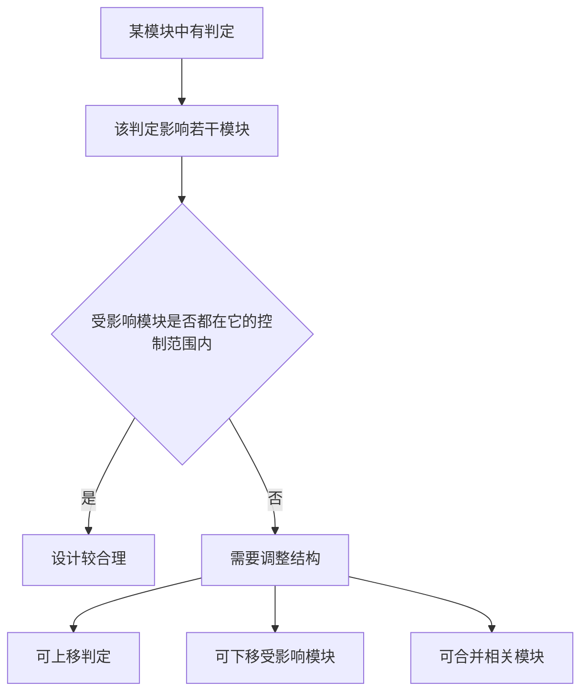

### 1. 知识点

| 原则 | 正确说法 | 常见错误选项 |
|---|---|---|
| 模块独立 | 高内聚、低耦合 | 高内聚高耦合、低内聚低耦合 |
| 模块规模 | 规模适中 | 模块越小越好 |
| 扇入扇出 | 扇入、扇出合理 | 过高扇出不加控制 |
| 信息隐蔽 | 模块内部数据不让其他模块直接访问 | 允许外部直接访问内部数据 |
| 作用范围与控制范围 | 作用范围应在控制范围之内 | 控制范围应在作用范围之内 |
| 病态连接 | 避免从中部进入模块、访问模块内部 | 通过非正常入口跳入模块 |

### 2. 作用范围与控制范围

| 概念 | 含义 | 做题理解 |
|---|---|---|
| 控制范围 | 一个模块本身及其所有直接或间接调用的下级模块 | 它能“管到”的模块范围 |
| 作用范围 | 受该模块中某个判定影响的所有模块 | 它的判断结果会“影响到”的范围 |
| 正确原则 | 作用范围应该在控制范围之内 | 不能让一个模块的判断影响到它管不到的地方 |



### 3. 例题分析

**例 1：划分软件系统模块时，应尽量做到什么？**  
题眼是“模块划分”。标准答案永远优先考虑**高内聚、低耦合**。

**例 2：模块规模越小越好是否正确？**  
错误。模块过小会增加接口数量和调用复杂度，可能导致系统结构碎片化。考试中“越小越好”属于绝对化干扰项，应改为“规模适中”。

**例 3：模块控制范围在其作用范围内是否正确？**  
错误。应是**作用范围在控制范围内**，不能反过来。

### 4. 记忆技巧

```text
设计原则三句：
高内聚，低耦合；
规模适中，扇入扇出适中；
作用在控制里，别从中间跳进去。
```
