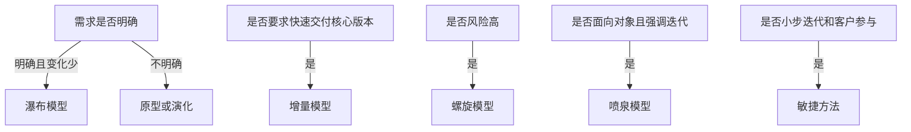

### 1. 知识点

| 模型 | 适用场景 | 不适合场景 | 高频题眼 |
|---|---|---|---|
| 瀑布模型 | 需求明确、变更少、领域熟悉 | 需求不清、变化频繁 | 大规模、类似项目、严格阶段 |
| 增量模型 | 需要快速交付核心版本 | 难以划分增量、管理复杂 | 第一个可交付版本、优先级高先交付 |
| 原型模型 | 捕获需求、用户说不清 | 大规模复杂系统 | 快速原型、用户反馈 |
| 演化模型 | 需求逐步明确、边用边改 | 管理控制要求极高 | 使用中不断改善 |
| 螺旋模型 | 大规模、高风险、技术新 | 成本敏感、风险分析能力弱 | 风险驱动 |
| 喷泉模型 | 面向对象开发 | 阶段边界要求明显 | 以对象为驱动、迭代、无明显边界 |
| UP/RUP | 用例和风险驱动、架构为中心 | 只考术语时易混阶段名称 | 初启、精化、构建、移交 |
| 敏捷方法 | 需求变化快、小步快跑 | 强计划、文档重型环境 | XP、Scrum、Crystal、AUP |

### 2. 流程图



### 3. 例题分析

**例 1：需求明确、项目规模较大、团队熟悉领域，应选什么模型？**  
先抓题眼：“需求明确”“规模较大”“领域熟悉”“类似项目经验”。  
再套知识点：这是瀑布模型最稳定的适用场景。  
**正确方向**：瀑布模型。

**例 2：技术含量高、客户相关风险多，应选什么模型？**  
先抓题眼：“技术含量高”“风险多”。  
再套知识点：螺旋模型是风险驱动的开发模型。  
**正确方向**：螺旋模型。

**例 3：图形用户/业务系统希望尽快投入使用，后续功能可改善，应选什么模型？**  
先抓题眼：“尽快投入使用”“使用过程中不断改善”。  
再套知识点：先上线可用版本，再迭代增强，符合演化或增量思想。  
**正确方向**：演化/迭代模型。

### 4. 记忆技巧

```text
需求明确瀑布走，需求不清原型救；
先交核心增量好，风险很高螺旋保；
面向对象喷泉绕，敏捷冲刺小步跑。
```

## UP、RUP 与敏捷方法

### 1. 知识点

| 方法           | 高频点                                   | 易错点                     |
| ------------ | ------------------------------------- | ----------------------- |
| RUP/UP       | 用例和风险驱动、架构为中心、迭代增量                    | 不是“确认阶段”，而是初启、精化、构建、移交  |
| 初启阶段         | 项目初始活动、商业论证                           | 不产生完整软件产品               |
| 精化阶段         | 需求分析、架构演进、生命周期架构里程碑                   | 常考“生命周期架构”              |
| 构建阶段         | 产生实现模型，构建系统                           | 结束时形成可集成的软件产品           |
| 移交阶段         | 软件提交、交付用户                             | 不是核心编码阶段                |
| XP(极限编程)     | 沟通、简单、反馈、勇气；小发布、重构、结对、持续集成            | 测试应尽早写，不是“编完后再写”        |
| Scrum(并列争球法) | Product Backlog、Sprint Backlog、Sprint | Refactoring 不是 Scrum 步骤 |
| Crystal(水晶法) | 每个项目需要不同策略、约定和方法论                     | 与 XP/Scrum 混淆           |
| AUP(敏捷统一过程)  | 大型任务连续，小型活动迭代                         | 不是 Crystal 的“每个系统一套方法论” |

### 2. 模板

```text
UP：谁做=角色，做什么=活动，产生什么=制品，何时做=工作流/阶段。
XP：沟通、简单、反馈、勇气。
Scrum：产品待办、冲刺待办、冲刺。
Crystal：项目不同，方法不同。
```

### 3. 例题分析

**例：RUP 用什么表述“谁做”？**  
先抓题眼：“谁做”。RUP 中“谁做”对应角色。  
**正确方向**：角色。

**例：30 天一次迭代称为冲刺的是哪种敏捷方法？**  
先抓题眼：“冲刺”“按优先级实现产品”“自组织小组”。  
**正确方向**：Scrum。

### 4. 记忆技巧

```text
RUP四阶段：初启定方向，精化定架构，构建做产品，移交给用户。
敏捷三句话：XP重实践，Scrum重冲刺，Crystal因项目而异。
```
