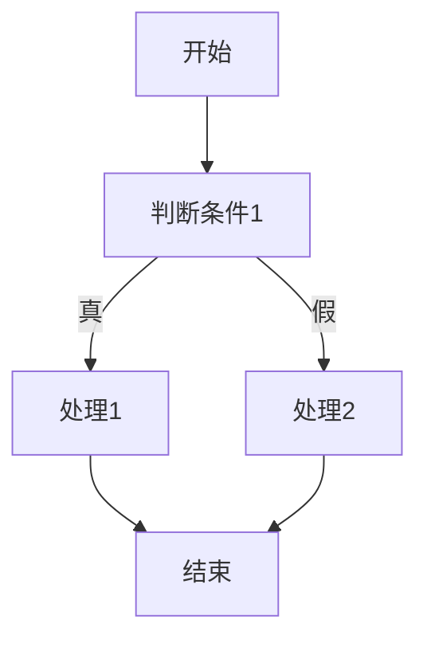

## 软件测试总表

### 1. 知识点

| 测试层次 | 重点 | 常考点 |
|---|---|---|
| 单元测试 | 模块内部 | 模块接口、局部数据、路径、边界、错误处理 |
| 集成测试 | 模块组合 | 自顶向下、自底向上、驱动、桩、回归测试 |
| 系统测试 | 完整系统 | 测试目标来自需求分析 |
| 验收测试 | 用户确认 | 是否满足用户需求 |
| 回归测试 | 修改后重测 | 修复一个错误后引入新错误 |

测试原则：

| 正确说法 | 错误说法 |
|---|---|
| 测试目的是发现错误 | 测试目的是证明程序正确 |
| 好测试能发现尚未发现的错误 | 软件测试能证明没有错误 |
| 测试用例要有输入和预期输出 | 只设计输入即可 |
| 要包含合理输入与不合理输入 | 只测合法输入即可 |

### 2. 集成测试对照

| 策略 | 需要什么 | 不需要什么 | 优点 |
|---|---|---|---|
| 自顶向下 | 桩模块 | 驱动模块 | 早期验证主控模块和设计问题 |
| 自底向上 | 驱动模块 | 桩模块 | 早期验证底层模块，并行度较高 |

### 3. 例题分析

**例：修复错误后，旧功能出错，最可能用什么测试发现？**  
题眼是“修改后引起原来正确运行的代码出错”。  
**正确方向**：回归测试。

**例：无法获得第三方组件源代码，应采用什么测试？**  
题眼是“无法获得源代码”。看不到内部逻辑，只能按功能接口测。  
**正确方向**：黑盒测试。

### 4. 记忆技巧

```text
单元测模块，集成测接口；系统看需求，验收看用户；改后怕牵连，回归再来测。
```

## 黑盒测试、白盒测试与 McCabe 度量

### 1. 黑盒测试

| 方法 | 题眼 | 说明 |
|---|---|---|
| 等价类划分 | 有效类、无效类 | 好用例通常不要一次混入多个无效输入 |
| 边界值分析 | 上下限、临界值 | 年龄 20—60，应测 19、20、60、61 |
| 错误推测 | 凭经验猜错 | 依据经验补充测试 |
| 因果图 | 多条件组合 | 条件和动作关系复杂 |

### 2. 白盒测试

| 覆盖准则 | 记忆 | 强弱 |
|---|---|---|
| 语句覆盖 | 每条语句至少执行一次 | 最弱 |
| 判定覆盖/分支覆盖 | 每个判断真假至少一次 | 中等 |
| 条件覆盖 | 每个条件真假至少一次 | 中等 |
| 判定/条件覆盖 | 判定和条件都覆盖 | 较强 |
| 路径覆盖 | 所有可能路径都覆盖 | 最强但成本高 |

### 3. McCabe 公式

$$
V(G)=m-n+2
$$

其中，$m$ 为有向边数，$n$ 为结点数。考试中还有两个快速方法：

$$
V(G)=判定结点数+1
$$

$$
V(G)=区域数
$$

### 4. Mermaid 示例



上图只有 1 个判定结点，所以 $V(G)=1+1=2$。

### 5. 例题分析

**例：McCabe 题让计算环路复杂度。**  
先抓题眼：边数、结点数、判定结点数。  
再套公式：若能数判定，优先用“判定结点数 + 1”。  
最后落答案：与选项匹配。

**例：等价类测试中哪个不是好用例？**  
先抓题眼：输入字段有多个约束。  
好测试用例通常一次只覆盖一个无效等价类；若一个用例同时混入多个无效条件，就不利于定位错误。  
最后落答案：选择“多个无效输入混在一起”的选项。

### 6. 记忆技巧

```text
黑盒不看代码，白盒盯逻辑；
语句最弱，路径最强；
McCabe不慌，判定加一。
```
